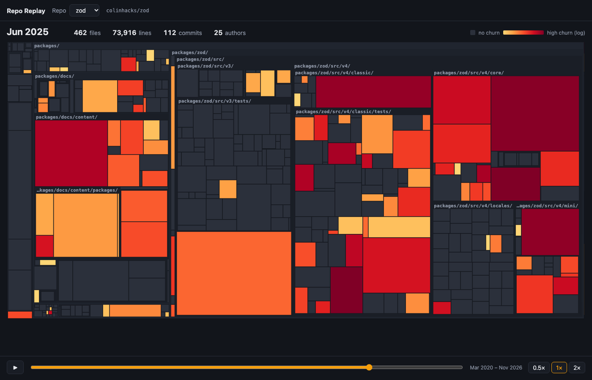

# Repo Replay

Watch a codebase grow, month by month.

Repo Replay reads a repository's git history and plays it back as an animated treemap.
Each tile is one file. Its area is the file's line count, and its color is how much the
file changed in that period. Files keep their tile when they are renamed or moved, so you
can follow one file across years of history.

**[Live demo](https://yosef-dev116.github.io/repo-replay/)**: pick zod or htmx and press play.



## Quick start

You need Node 24 or later and git.

```sh
npm install
npm run dev
```

Open http://localhost:5173. The repo includes data for two demo repos,
[zod](https://github.com/colinhacks/zod) and [htmx](https://github.com/bigskysoftware/htmx).
Pick one and press play.

## Replay your own repo

```sh
npm run extract -- path/to/your/clone -o web/public/data/my-repo.json --name you/my-repo
npm run dev
```

The new file shows up in the repo menu. Extraction reads `git log` only. It does not
check out old versions, so it takes seconds, even for repos with years of history.

| Option | Meaning |
|---|---|
| `-o <file>` | Output JSON file. Required. |
| `--name owner/repo` | Name shown in the viewer. Default: the folder name. |
| `--max-months N` | Maximum number of frames. Default: 120. |

## Viewer links

| URL parameter | Effect |
|---|---|
| `?repo=zod.json` | Open this repo. |
| `?month=2025-06` | Open at this month. Use it to link to a moment in history. |
| `?fps` | Show a frames-per-second meter, for checking smoothness. |

## How it works

```
git log --numstat ──► cli/ ──► one JSON file per repo ──► web/ (React + D3 treemap)
```

1. **Read history.** `cli/src/git.ts` streams `git log --numstat` along the first-parent
   line. Each commit gives lines added and deleted per file, plus renames.
2. **Track identity.** `cli/src/identity.ts` gives each file a stable id. A rename keeps
   the id, so the tile moves instead of disappearing. A file deleted and added again later
   gets a new id. `cli/src/renames.ts` parses git's brace rename syntax, such as
   `src/{old => new}/a.ts`.
3. **Take snapshots.** `cli/src/build.ts` records every live file at the end of each
   month. A repo with more than 120 months is sampled down to 120 frames. A skipped
   month's churn, commits and authors are added to the next frame, so nothing is lost.
4. **Hide noise.** `cli/src/ignore.ts` hides lockfiles, `node_modules`, `vendor`, `dist`,
   `build`, minified files, version-numbered release copies, and secret-like files such
   as `.env`. Without this, `package-lock.json` was 77% of htmx's first frame. Hidden files
   are still tracked, so a file that moves out of a hidden folder keeps its history.
5. **Draw.** `web/src/Treemap.tsx` lays out files with a binary treemap grouped by
   folder. A keyed D3 join uses the file id, so tiles animate between months. Color uses
   a log scale of churn. Grey means no change in that period.

## Development

```sh
npm test            # CLI unit tests (Vitest)
npm run lint        # CLI typecheck + web lint
npm run build       # production build into web/dist
npm run demo-data   # rebuild the demo JSON from pinned commits
```

`npm run demo-data` clones zod and htmx into `.demo-repos/` at the commits pinned in
`scripts/demo-data.sh`. It produces the same files that are committed.

To host the viewer under a sub-path, such as GitHub Pages, build with
`npx vite build --base=/repo-replay/` in `web/`.

## Known limits

- The noise filter does not catch third-party libraries copied into ordinary folders.
  For example, htmx has large vendored files under `test/lib/` and `test/ws-sse/static/`.
- History follows the first-parent line, so work on merged branches is counted on the
  month of its merge commit.
- Size grows with files × months. The demos are 155–372 KB gzipped. A large monorepo
  needs a more compact data format.
