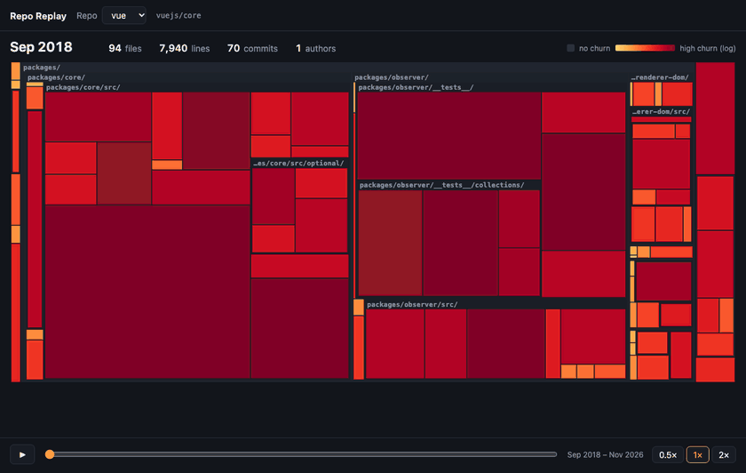

# Repo Replay

Watch a codebase grow, month by month.

Repo Replay reads a repository's git history and plays it back as an animated treemap.
Each tile is one file. Its area is the file's line count, and its color is how much the
file changed in that period. Files keep their tile when they are renamed or moved, so you
can follow one file across years of history.

[Live demo](https://yosef-dev116.github.io/repo-replay/?repo=vue.json): pick Vue, zod or htmx and press play.



*Vue (`vuejs/core`), 2018–2026. Red tiles changed a lot that month. Grey tiles did not change.*

## Replay your own repo

Run this inside any git repo. You need Node 20 or later.

```sh
npx repo-replay
```

It reads the history, starts a viewer on your own machine, and opens it in your browser.
Your code and history never leave your computer, so it is safe for private repos.
It reads `git log` only, so it is fast. Vue's 8 years of history take about 3 seconds.

| Option | Meaning |
|---|---|
| `[path]` | The repo to replay. Default: the current folder. |
| `-o <file.json>` | Write the data to a file instead of opening the viewer. |
| `--name owner/repo` | Name shown in the viewer. Default: the folder name. |
| `--max-months N` | Maximum number of frames. Default: 120. |
| `--port N` | Port for the viewer. Default: any free port. |
| `--no-open` | Print the URL, but do not open a browser. |

## Viewer links

| URL parameter | Effect |
|---|---|
| `?repo=zod.json` | Open this repo. |
| `?month=2025-06` | Open at this month. Use it to link to a moment in history. |

## How it works

```
git log --numstat ──► cli/ ──► one JSON file per repo ──► web/ (React + D3 treemap)
```

1. **Read history.** `cli/src/git.ts` streams `git log --numstat` along the first-parent
   line. Each commit gives lines added and deleted per file, plus renames.
2. **Track identity.** `cli/src/identity.ts` gives each file a stable id. A rename keeps
   the id, so the tile moves instead of disappearing. A file deleted and added again later
   gets a new id. `cli/src/renames.ts` parses git's brace rename syntax, such as
   `src/{old => new}/a.ts`.
3. **Take snapshots.** `cli/src/build.ts` records every live file at the end of each
   month. It samples a repo with more than 120 months down to 120 frames. It adds the
   churn, commits and authors of each skipped month to the next frame, so the totals
   stay correct.
4. **Hide noise.** `cli/src/ignore.ts` hides lockfiles, `node_modules`, `vendor`, `dist`,
   `build`, minified files, version-numbered release copies, and secret-like files such
   as `.env`. Without this filter, `package-lock.json` is 77% of htmx's first frame. The CLI
   still tracks hidden files, so a file that moves out of a hidden folder keeps its history.
5. **Draw.** `web/src/Treemap.tsx` lays out files with a binary treemap grouped by
   folder. A keyed D3 join uses the file id, so tiles animate between months. Color uses
   a log scale of churn. Grey means no change in that period.

## Development

Clone the repo, then:

```sh
npm install
npm run dev         # viewer with the demo data at http://localhost:5173
npm test            # CLI unit tests (Vitest)
npm run lint        # CLI typecheck + web lint
npm run build       # production build into web/dist
npm run demo-data   # rebuild the demo JSON from pinned commits
npm run extract -- path/to/repo -o web/public/data/my-repo.json   # add a repo to the dev viewer
```

`npm run demo-data` clones Vue, zod and htmx into `.demo-repos/` at the commits pinned in
`scripts/demo-data.sh`. It produces the same files that are committed.

`cli/` is the npm package. `npm pack` in `cli/` bundles the CLI into one file and adds the
built viewer, so the package has no dependencies.

To host the viewer under a sub-path, such as GitHub Pages, build with
`npx vite build --base=/repo-replay/` in `web/`.

## Known limits

- The noise filter does not catch third-party libraries copied into ordinary folders.
  For example, htmx has large vendored files under `test/lib/` and `test/ws-sse/static/`.
- History follows the first-parent line, so the CLI counts work on a merged branch in
  the month of its merge commit.
- Size grows with files × months. The demos are 155–658 KB gzipped. A large monorepo
  needs a more compact data format.

## License

MIT. See [LICENSE](LICENSE).
